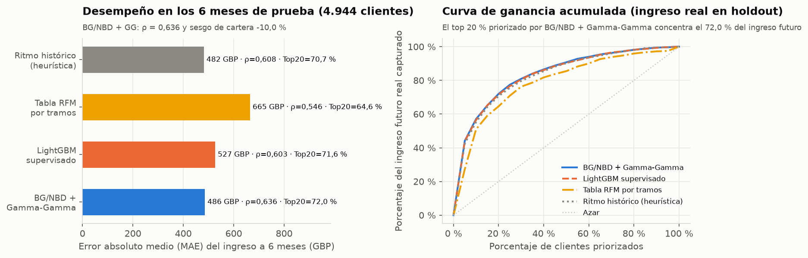

🇪🇸 [Español (full version)](README.md) · 🇬🇧 **English (summary)**

# 💎 Who is still alive and how much are they worth? CLV and retention in retail (BG/NBD + Gamma-Gamma)

A probabilistic system that estimates **which customers are still active**, **how often they will buy**, **their average
ticket** and **whom it pays to win back** in a retailer where churn happens silently. Evaluated on **UCI Online Retail II**
(**1.07 million lines**, 2009–2011, a British gift store) with a temporal split.

## Results (test: 4,944 customers in the following 6 months, `2011-06-10 → 2011-12-09`)

| Metric on 183 never-seen days | Historical pace | RFM table | Supervised LightGBM (hurdle) | **BG/NBD + Gamma-Gamma** |
|---|---:|---:|---:|---:|
| AUC of the 6-month repurchase probability | 0.762 | 0.774 | 0.800 | **0.810** |
| Brier (lower is better) | 0.2178 | 0.2006 | 0.1897 | **0.1774** |
| Bias of the total purchase count | −3.2% | −21.8% | −26.9% | **−1.4%** |
| Spearman correlation (revenue) | 0.608 | 0.546 | 0.603 | **0.636** |
| Aggregate error of portfolio revenue | −12.4% | −23.8% | −40.9% | **−10.0%** |
| Future revenue captured in the **top 10%** | 55.2% | 51.0% | 56.5% | **57.1% (lift 5.7×)** |
| Future revenue captured in the **top 20%** | 70.7% | 64.6% | 71.6% | **72.0% (lift 3.6×)** |

**Is the advantage over LightGBM significant?** (paired bootstrap, 1,000 resamples) Repurchase AUC +0.010 [+0.004; +0.017]: yes.
Brier −0.0124 [−0.0158; −0.0086]: yes. Top-20% capture +0.4 pp [−0.6; +1.2]: **no**.

👉 BG/NBD + Gamma-Gamma ranks and calibrates better than LightGBM, with **small but significant** differences, and its portfolio
revenue is much more accurate. For choosing **whom to prioritize**, the two models are equivalent. LightGBM and the RFM table
were trained on an earlier window whose target semester does not include the Christmas season (explained in the full README).

**Math, retention campaign, limitations, API and reproduction commands:** [full README (Spanish)](README.md). Commands are
language-independent.
