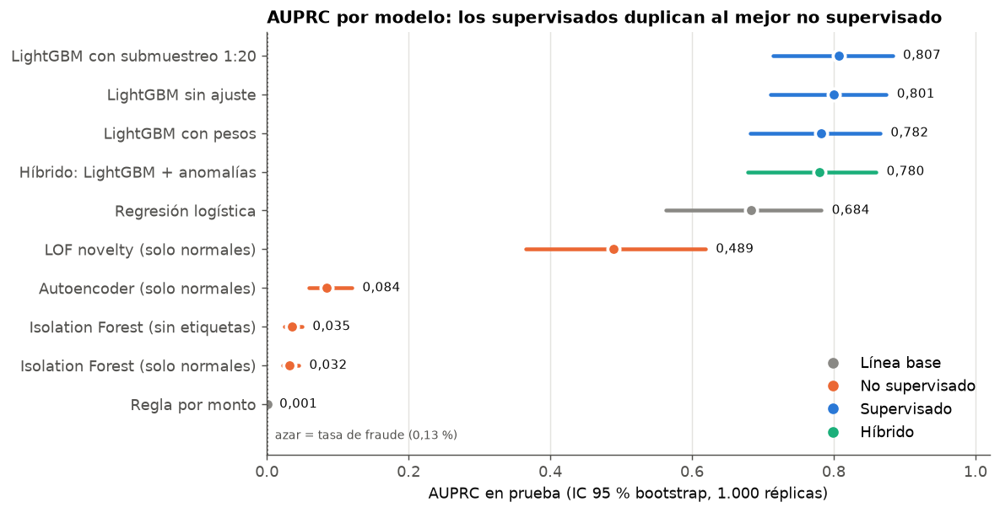

🇺🇸 **English (summary)** · 🇪🇸 [Español (full version)](README.es.md)

# 💳 Card fraud detection: unsupervised anomalies vs. supervised models

**Data:** 284,807 real transactions by European cardholders (ULB / Worldline, two days in September 2013), with **492 frauds
(0.17%)**.

Is it necessary to label fraud, or is looking for what is **unusual** enough? This project compares, with a **temporal split**
(train on the past, evaluate on the future): baselines, unsupervised models (Isolation Forest, LOF, a PyTorch autoencoder),
supervised models (LightGBM untuned, weighted and undersampled) and a hybrid. Decisions use the **cost of each error** with the
real `Amount`.

## Test results (last 7.7 hours: 56,962 transactions, 75 frauds)

Main metric: **AUPRC**. With 0.13% fraud, a random model gets AUPRC ≈ 0.0013 and "everything is normal" has 99.87% accuracy: that
is why **accuracy is never reported**.

| Family | Model | AUPRC [95% CI] | ROC-AUC | Precision@80 | Savings vs. no model |
|:---|:---|---:|---:|---:|---:|
| Supervised | LightGBM, 1:20 undersampling | 0.807 [0.715; 0.883] | 0.984 | 73.8% | 62.0% |
| Supervised | LightGBM, untuned | 0.801 [0.710; 0.874] | 0.981 | 72.5% | 58.1% |
| Supervised | **LightGBM, weighted** ⭐ | 0.782 [0.682; 0.865] | 0.928 | 72.5% | 52.8% |
| Hybrid | LightGBM + anomaly scores | 0.780 [0.679; 0.860] | 0.924 | 71.2% | 57.9% |
| Baseline | Logistic regression | 0.684 [0.563; 0.782] | 0.972 | 67.5% | 55.5% |
| Unsupervised | LOF novelty | 0.489 [0.366; 0.619] | 0.936 | 55.0% | 40.5% |
| Unsupervised | Autoencoder | 0.084 [0.059; 0.120] | 0.928 | 2.5% | 29.5% |
| Unsupervised | Isolation Forest (no labels) | 0.035 [0.025; 0.050] | 0.950 | 0.0% | −10.0% |

⭐ Model served by the API: the highest AUPRC **on validation**. On the test set, the three LightGBMs and the hybrid cannot be told
apart.

- **Supervised wins comfortably:** paired difference vs. the best unsupervised model 0.284 [0.184; 0.387].
- **Unusual is not the same as fraudulent:** Isolation Forest and the autoencoder have a good-looking ROC-AUC, but their first
  alerts are unusual legitimate purchases.
- **With only 5 labeled frauds**, a logistic regression already beats the best unsupervised model.
- **The handling of imbalance does not change the ranking**, and the hybrid adds nothing: −0.002 [−0.017; 0.012].

**Full tables, SHAP, drift, API, app and reproduction commands:** [full README (Spanish)](README.es.md). Commands are
language-independent.
