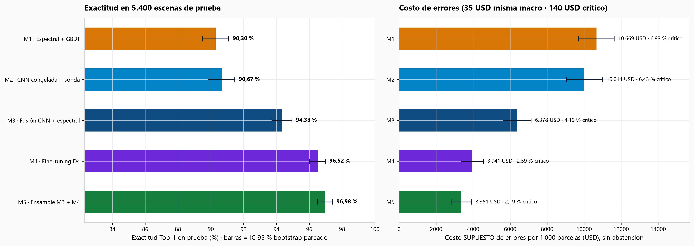

🇪🇸 [Español (full version)](README.md) · 🇬🇧 **English (summary)**

# 🛰️ Land use with Sentinel-2 (EuroSAT): spectral indices vs. transfer learning on CPU

**Data:** 27,000 EuroSAT RGB scenes in their official splits: **16,200 training · 5,400 validation · 5,400 test**.

Are **spectral indices and texture** enough to classify land use from space, or does **transfer learning with convolutional
networks trained only on CPU** pay off? Five models are compared on the 10 EuroSAT classes (64×64 px patches at 10 m/pixel). The
whole pipeline takes **11.3 min** on a Ryzen 5 4600G with 4 threads and no GPU.

## Test results (5,400 never-seen scenes)

| Model (CPU) | Top-1 accuracy [95% CI] | Macro-F1 | ECE | Critical errors | Assumed cost / 1,000 plots |
|:---|---:|---:|---:|---:|---:|
| **M1** · 54 spectral indices + texture + GBDT | 90.30% [89.50; 91.09] | 0.8988 | 0.0116 | 374 (6.93%) | 10,669 USD |
| **M2** · Frozen MobileNetV3 + linear probe | 90.67% [89.83; 91.46] | 0.9035 | 0.0077 | 347 (6.43%) | 10,014 USD |
| **M3** · Fusion: CNN embeddings + 54 indices + MLP | 94.33% [93.72; 94.94] | 0.9419 | 0.0062 | 226 (4.19%) | 6,378 USD |
| **M4** · Partial fine-tuning of MobileNetV3 | 96.52% [96.00; 96.98] | 0.9639 | 0.0061 | 140 (2.59%) | 3,941 USD |
| **M5** · Calibrated ensemble 0.75·M4 + 0.25·M3 | **96.98%** [96.50; 97.41] | **0.9688** | **0.0059** | **118 (2.19%)** | **3,351 USD** |

The cost matrix is **assumed**, not measured: 18 USD per human review, 35 USD per error within the same macro-category and 140 USD
per critical error.

- A frozen CNN is **not** significantly better than spectral indices (M2 − M1: +0.37 [−0.61; +1.33]); adding the indices to the
  frozen CNN is (+3.67 [+3.00; +4.39]).
- Everything that is **tuned** is decided on the validation split; the test set is only used for reporting.

**Calibration, abstention, robustness, Grad-CAM, ONNX, API, app and reproduction commands:** [full README (Spanish)](README.md).
Commands are language-independent.
