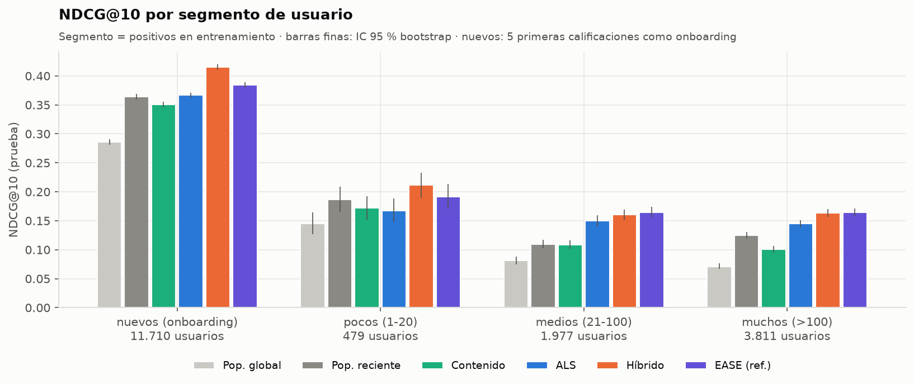

🇪🇸 [Español (full version)](README.md) · 🇬🇧 **English (summary)**

# 🎬 What movie to watch now? Recommender on MovieLens 25M

A movie recommender trained on **25 million ratings** by 162 thousand users (MovieLens 25M, 1995 → 2019). It combines **implicit
collaborative filtering (ALS)**, a **content model** with genres and the **Tag Genome** (1,128 tags per movie) and **recent
popularity** in a hybrid that adapts to how much history each user has.

The question is not "what rating would they give?" but **"which 10 movies do I show today so that they watch one and like it?"**:
ranking metrics, no looking into the future, serving users without history, and not recommending only hits.

## Results (test: train < 2018-01-01, evaluate 2018-01 → 2019-11)

**Existing users** (6,267 with history who came back after the cut-off). Top-10; 95% CI in brackets.

| Model | Precision@10 | Recall@10 | **NDCG@10** | Coverage |
|---|---:|---:|---:|---:|
| Global popularity | 0.067 | 0.031 | 0.080 | 1.8% |
| Recent popularity (180 days) | 0.106 | 0.057 | 0.125 | 1.4% |
| Content (genres + genome) | 0.094 | 0.045 | 0.109 | 4.2% |
| Implicit ALS | 0.127 | 0.060 | 0.148 | **12.7%** |
| **Hybrid (ALS + content + recent)** | **0.142** | **0.072** | **0.166** [0.161–0.171] | 6.2% |
| EASE (reference, not served) | 0.141 | 0.070 | 0.167 [0.161–0.172] | 11.2% |

For **new users** (5-movie onboarding, 11,710 users) the hybrid reaches NDCG@10 **0.415**, vs. 0.367 for ALS, 0.364 for recent
popularity and 0.385 for EASE.

**Honest reading**
- **Recent popularity is a tough baseline** in a temporal split, because people watch new releases.
- **Accuracy vs. discovery:** the hybrid wins NDCG by pushing towards what is popular (6.2% coverage vs. 12.7% for ALS).
- It ties with EASE on existing users.

**All segments, figures, API, app and reproduction commands:** [full README (Spanish)](README.md). Commands are
language-independent.
